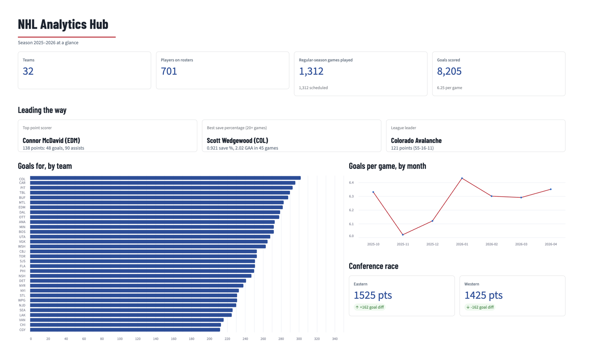
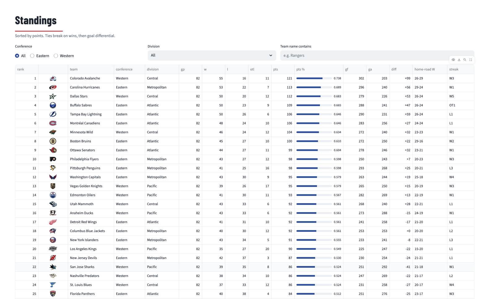
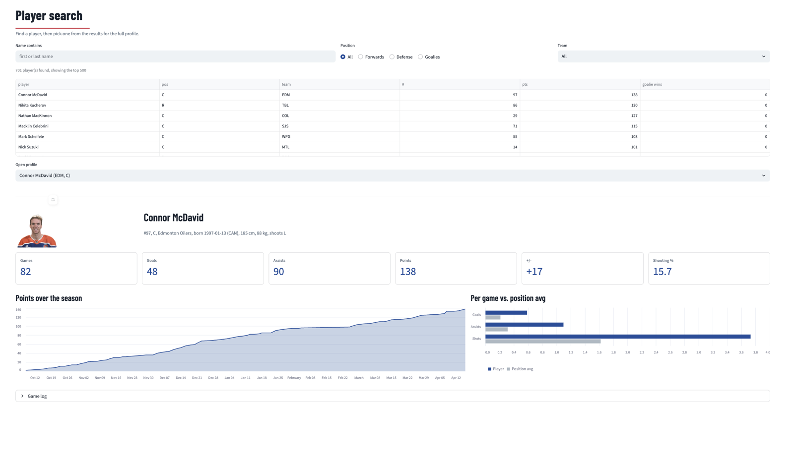
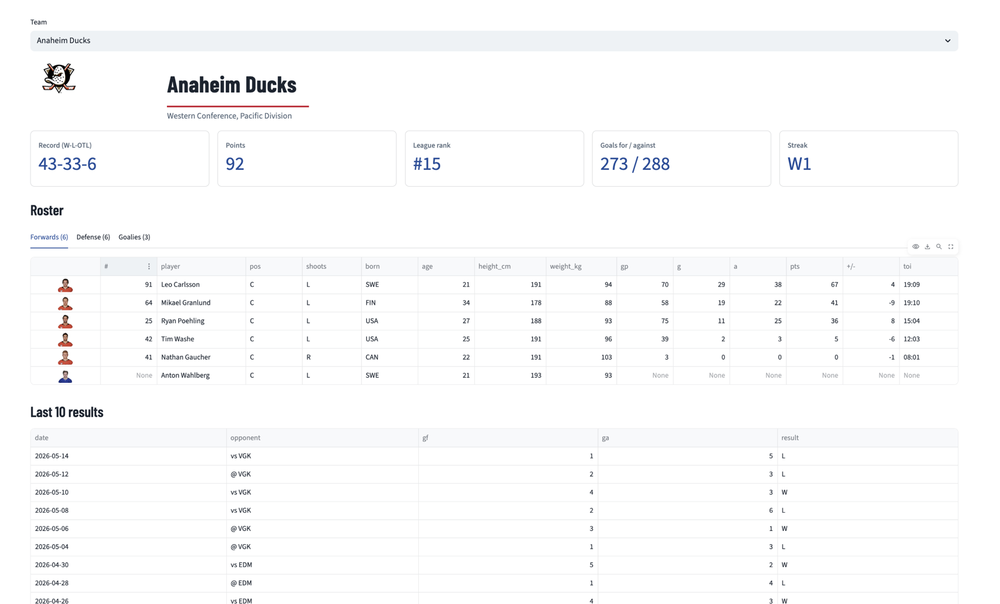
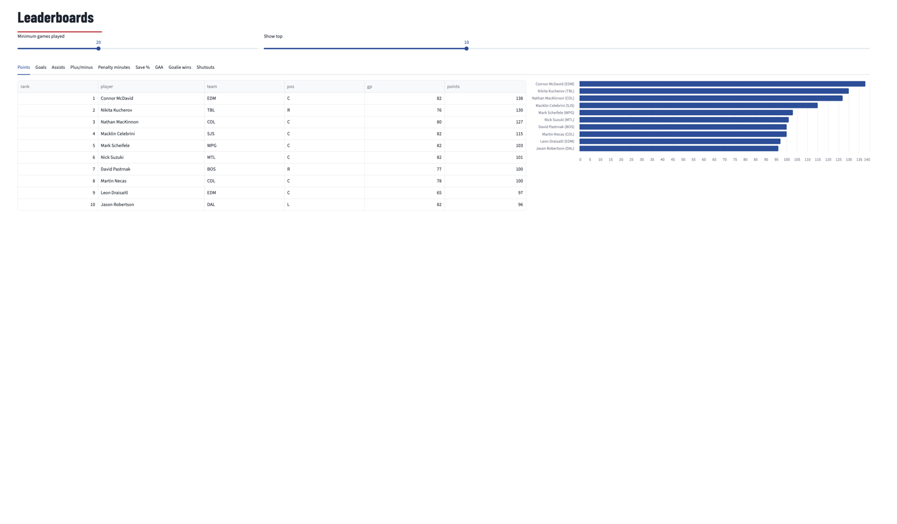
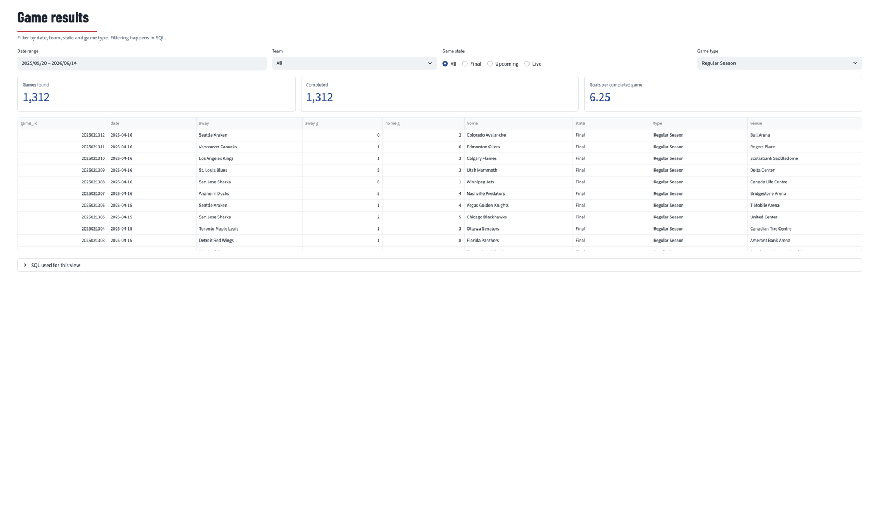
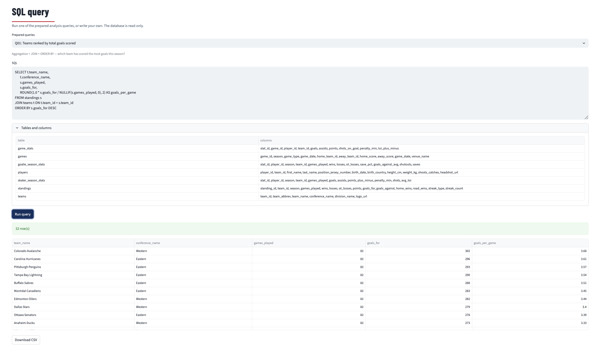

# NHL Analytics Hub


An end-to-end data pipeline and dashboard built on the public NHL API: JSON is pulled from six endpoints, flattened and validated in Python, loaded into a 7-table relational schema, analysed with SQL, and explored through a multi-page Streamlit app.

| | |
|---|---|
| **Database** | SQLite (`data/nhl.db`) |
| **Connector** | Python's built-in `sqlite3` |
| **Season** | 2025-26 (`20252026`, configurable) |
| **Dashboard** | Streamlit + `streamlit-option-menu`, 7 pages |
| **Python** | 3.10 or newer |



## Quick start

```bash
git clone <your-repo-url> nhl-analytics-hub
cd nhl-analytics-hub
python -m venv .venv && source .venv/bin/activate     # Windows: .venv\Scripts\activate
pip install -r requirements.txt

python run_pipeline.py          # build data/nhl.db from the live NHL API
streamlit run app.py            # open http://localhost:8501
```

A full live build makes roughly 1,400 API calls (mostly box scores) and takes about 10 minutes with the polite 0.35 s delay. Box scores of finished games are cached in `data/raw/api_cache/`, so later rebuilds are much faster. For a quick check, cap the box scores: `python run_pipeline.py --max-boxscores 50`.

**No network?** `python run_pipeline.py --source demo` builds the same database from a synthetic season served in the exact JSON shape of the real endpoints, so the same parsers run. Team names and divisions are real; every player, score and stat is random, and the dashboard shows a banner saying so.

### Using the provided datasets

Download `game_stats_data`, `skater_season_stats_data` and `goalie_season_stats_data` from the links in the brief and save them in `data/raw/datasets/` (CSV, JSON, JSONL, XLSX or Parquet; file names must start with `game_stats`, `skater_season_stats`, `goalie_season_stats`). The pipeline uses them for tables 5–7 automatically. Without them, those tables are built from the API (`gamecenter/{id}/boxscore` and `club-stats/{team}/{season}/2`).

Column names are matched loosely (`playerId`, `player_id`, `PLAYER ID` all work), common API names are aliased (`sog`, `pim`, `savePctg` …), and `team_id` is resolved safely: by team abbreviation when present, otherwise checked against the roster and remapped if the file uses a different numbering.

## Screenshots

| Standings | Player Search |
|---|---|
|  |  |
| **Team Info** | **Leaderboards** |
|  |  |
| **Game Results** | **SQL Query** |
|  |  |

## Highlights from the 2025-26 data

- 32 teams, 701 rostered players, 1,312 regular-season games and 8,205 goals (6.25 per game).
- Colorado led the league with 121 points (55–16–11); Connor McDavid led scoring with 138 points (48 G, 90 A).
- Nikita Kucherov scored 130 points in 76 games, a higher per-game rate than McDavid (1.71 vs 1.68).
- The Eastern Conference finished +162 in goal differential against the West.

## Project structure

```
nhl-analytics-hub/
├── app.py                       Streamlit dashboard (7 pages)
├── run_pipeline.py              CLI entry point for the ETL
├── requirements.txt
├── .github/workflows/tests.yml   CI: runs pytest on every push (offline)
├── docs/screenshots/            dashboard screenshots used in this README
├── notebooks/
│   ├── 01_api_exploration.ipynb   inspect every endpoint's raw JSON
│   ├── 02_parse_and_load.ipynb    parse → validate → load all 7 tables
│   └── 03_sql_analysis.ipynb      run the 15 analysis queries
├── sql/
│   ├── schema.sql               CREATE TABLE statements (PK, FK, NOT NULL, UNIQUE, indexes)
│   └── analysis_queries.sql     15 named queries (shared by notebook 03 and the SQL page)
├── src/nhl_pipeline/
│   ├── config.py                season, URLs, delays, paths (all env-overridable)
│   ├── api_client.py            requests session: delay, retries/back-off, raw JSON cache
│   ├── parsers.py               pure JSON → row functions, one per endpoint
│   ├── datasets.py              loader for the three provided dataset files
│   ├── db.py                    connect, schema, INSERT OR IGNORE, FK gate, query loader
│   ├── pipeline.py              orchestration, run report, quality checks
│   ├── query_builder.py         dynamic, parameterised WHERE clauses for the UI
│   └── demo.py                  offline synthetic data source
├── tests/                       pytest: parsers, loader, full pipeline, every query, every page
└── data/
    ├── nhl.db                   generated (git-ignored)
    └── raw/{api_cache,datasets}/
```

## Schema

| # | Table | Source | Key design points |
|---|---|---|---|
| 1 | `teams` | `/v1/standings/now` | `team_id` generated (API only gives `teamAbbrev`); `team_abbrev` UNIQUE; ids assigned alphabetically so they are stable across rebuilds |
| 2 | `standings` | `/v1/standings/now` | FK → teams; UNIQUE (team_id, season) |
| 3 | `players` | `/v1/roster/{team}/{season}` | `player_id` from the API; forwards, defensemen, goalies flattened; imperial units converted when metric is missing |
| 4 | `games` | `/v1/club-schedule-season/{team}/{season}` | each game arrives twice (once per club) → `INSERT OR IGNORE` on `game_id`; raw `game_state` codes kept, labels applied in the UI |
| 5 | `game_stats` | dataset / box scores | skaters only; UNIQUE (game_id, player_id); `game_id` indexed but not an FK, as in the brief |
| 6 | `skater_season_stats` | dataset / club-stats | routed by position ≠ `G`; UNIQUE (player_id, season, team_id) so traded players keep one row per club |
| 7 | `goalie_season_stats` | dataset / club-stats | routed by position = `G`; `save_pct` normalised to 0–1 |

## How the pipeline stays correct

- **Referential integrity before insert.** SQLite's `INSERT OR IGNORE` skips duplicate keys but not foreign-key failures, so every child row is checked against its parent keys in Python first. Orphans (e.g. preseason games against European clubs, stat lines for players no longer on a roster) are counted in the run report rather than silently lost or crashing the load.
- **Full rebuild, atomic swap.** Each run builds a fresh database in a temp file and replaces `data/nhl.db` only when everything succeeded. Re-running always reflects the latest standings and scores, and the dashboard never reads a half-built file.
- **Post-load quality checks.** Zero FK violations, no empty tables, `points = goals + assists`, `standings points = 2·W + OTL`, finished games have scores, save % within 0–1. Results are printed and saved to `data/nhl.run.json`.
- **Polite API use.** Fixed delay between calls, exponential back-off on 429/5xx, and only immutable resources (finished-game box scores) are served from cache; standings, rosters and schedules are always fetched fresh.

## Dashboard

| Page | What it does |
|---|---|
| Home | KPI cards (teams, players, games, goals), top scorer, best goalie, league leader, goals-by-team and monthly scoring charts |
| Standings | Full table with logos and points %, filtered by conference (radio), division (selectbox) and team search (text input) |
| Team Info | Logo, record, rank, streak; roster split into forwards / defense / goalies with season stats; last 10 results |
| Player Search | Search by name, position and team; profile with headshot, stat cards, cumulative-points chart and comparison to position average |
| Game Results | Date range (date input), team, game state (radio) and game type filters; the SQL used is shown in an expander |
| Leaderboards | Tabs for points, goals, assists, +/-, PIM, save %, GAA, wins, shutouts with a minimum-games slider |
| SQL Query | Dropdown of the 15 prepared queries plus a free-form editor; results in `st.dataframe`, CSV download |

Filters are **pushed down into SQL**: `WhereBuilder` adds a condition only for filters the user actually set, and every value is a bound parameter (no string formatting, so no SQL injection). The database is opened read-only (`mode=ro` + `PRAGMA query_only`), and the SQL page accepts a single `SELECT`/`WITH` statement, with clear messages for empty, invalid or blocked queries.

Deep links work: `http://localhost:8501/?page=Leaderboards`, `?page=Team%20Info&team=Toronto`.

## Analysis queries

`sql/analysis_queries.sql` holds 15 queries covering aggregation, JOINs (including a self-join), scalar and correlated subqueries, derived tables, a window function, GROUP BY / HAVING and date functions:

Q01 teams ranked by goals scored · Q02 top 5 point scorers · Q03 20+ goals and 30+ assists · Q04 teams above league-average points · Q05 divisions averaging 90+ points · Q06 best save % · Q07 top scorer on every team · Q08 home vs road wins · Q09 biggest blowouts · Q10 points-per-game leaders from game logs · Q11 players with 2× their team's average · Q12 goal differential by conference · Q13 scoring by month · Q14 penalty-minute leaders · Q15 roster make-up by birth country

Q05 can legitimately return no rows early in a season, before any division averages 90 points.

## Configuration

All settings live in `src/nhl_pipeline/config.py` and can be overridden with environment variables:

| Variable | Default | Purpose |
|---|---|---|
| `NHL_SEASON` | `20252026` | Season to load |
| `NHL_ROSTER_SCOPE` | `season` | `season` → `/roster/{team}/{SEASON}`; `current` → `/roster/{team}/current` (the endpoint named in the brief) |
| `NHL_REQUEST_DELAY` | `0.35` | Seconds between API calls |
| `NHL_STATS_GAME_TYPES` | `2` | Game types to pull box scores for (`2,3` adds playoffs) |
| `NHL_DB_PATH` | `data/nhl.db` | Database file used by the pipeline and the dashboard |

**Why `season` is the roster default:** outside the season, `/roster/{team}/current` returns *next* season's rosters. Players who have since moved on would then be missing from `players`, and their 2025-26 stat rows would fail the foreign key. The season roster lines up with the season's stats. Set `NHL_ROSTER_SCOPE=current` to follow the brief literally; any dropped rows are reported in the run output.

## Tests

```bash
pytest -q
```

50 tests: every parser against API-shaped fixtures (localised names, missing scores, unit conversion, duplicate and orphan games, position routing), the dataset loader (camelCase columns, foreign team numbering, percent-scale save %), the WHERE builder (unset filters, LIKE escaping), the live API's L/R winger codes, a full demo build (all 7 tables, duplicates ignored, zero FK violations, idempotent rebuild), all 15 queries, and a render of every dashboard page.

## Notes

- The NHL web API is public and unofficial; endpoints and fields can change without notice. Parsers read every field with `.get()` and fall back gracefully, and anything unexpected shows up in the run report's warnings.
- To use MySQL or PostgreSQL instead, swap the connector in `db.connect()`, change `INSERT OR IGNORE` to `INSERT IGNORE` / `ON CONFLICT DO NOTHING`, and adjust `AUTOINCREMENT` and the date functions in a few queries (`strftime`, `julianday`).
